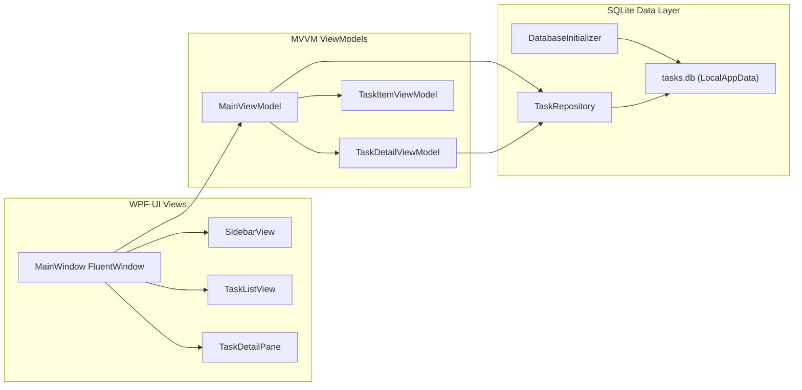

# WPF Fluent Task Tracker (`TaskTracker2`) — Plan v1

> Build a modern Windows 11 Fluent WPF task tracker in C# (.NET 10, WPF-UI, CommunityToolkit.Mvvm, Microsoft.Data.Sqlite) backed by the existing local SQLite database with backward-compatible extensions for custom lists, subtasks, themes, search/sorting, shortcuts, and undo.

## Architecture & Tech Stack
- **Framework**: `.NET 10` (`net10.0-windows`, WPF) with C# nullable enabled.
- **UI Toolkit**: `WPF-UI` (v4.x) for `FluentWindow`, Mica backdrop, Fluent icons, Light/Dark/System theming (`ApplicationThemeManager`), and `SnackbarPresenter`.
- **Architecture**: Clean MVVM using `CommunityToolkit.Mvvm` (`[ObservableProperty]`, `[RelayCommand]`) and `Microsoft.Data.Sqlite` for direct, lightweight SQLite access with zero schema drift against the existing DB.

## Database Schema & Backward Compatibility
Target file: `%LOCALAPPDATA%\TaskTracker\tasks.db` (`C:\Users\kyran\AppData\Local\TaskTracker\tasks.db`).

- **Preserve existing `Tasks` columns and formats**:
  - `Id INTEGER PRIMARY KEY`
  - `Title TEXT NOT NULL`
  - `Notes TEXT`
  - `DueDate TEXT` (`yyyy-MM-DD`, nullable)
  - `Priority INTEGER NOT NULL` (`1 = Low`, `2 = Normal`, `3 = High`; default `2 = Normal` for new tasks)
  - `IsComplete INTEGER NOT NULL` (`0` or `1`)
  - `CreatedAt TEXT NOT NULL` (ISO-8601 UTC round-trip `"O"`)
- **Additive, idempotent startup migrations** in `Data/DatabaseInitializer.cs` (with `PRAGMA foreign_keys = ON`):
  - Create `TaskLists` (`Id`, `Name`, `ColorHex`, `IconName`, `SortOrder`, `CreatedAt`) if not exists.
  - Check `PRAGMA table_info(Tasks)` and run `ALTER TABLE Tasks ADD COLUMN ListId INTEGER REFERENCES TaskLists(Id) ON DELETE SET NULL` only if missing (nullable, so all existing rows remain valid).
  - Create `Subtasks` (`Id`, `TaskId` FK `ON DELETE CASCADE`, `Title`, `IsComplete`, `SortOrder`) if not exists.
  - Create `AppSettings` (`Key TEXT PRIMARY KEY`, `Value TEXT NOT NULL`) to persist theme (`System` / `Light` / `Dark`) and sort preference.

## Project Structure
- [TaskTracker2.sln](TaskTracker2.sln) and [TaskTracker2.csproj](TaskTracker2.csproj) — Solution, WPF project, and NuGet references (`WPF-UI`, `CommunityToolkit.Mvvm`, `Microsoft.Data.Sqlite`).
- [App.xaml](App.xaml) and [App.xaml.cs](App.xaml.cs) — WPF-UI resource dictionaries, startup DB initialization, saved theme application, and `MainWindow` launch.
- [Models/](Models/) — `TaskPriority.cs` (`Low = 1`, `Normal = 2`, `High = 3`), `SmartViewType.cs`, `TaskItem.cs`, `TaskList.cs`, `SubtaskItem.cs`.
- [Data/DatabasePaths.cs](Data/DatabasePaths.cs) — Resolves `%LOCALAPPDATA%\TaskTracker\tasks.db` (and ensures directory exists).
- [Data/DatabaseInitializer.cs](Data/DatabaseInitializer.cs) — Safe, additive schema creation and migration.
- [Data/TaskRepository.cs](Data/TaskRepository.cs) — Async CRUD for tasks, lists, subtasks, settings, plus full-snapshot restore (`RestoreTaskAsync`) for undo.
- [ViewModels/MainViewModel.cs](ViewModels/MainViewModel.cs) — Smart view & custom list filtering, live counts, instant search, sorting (`Due Date`, `Priority`, `Newest`, `Title`), quick-add, soft-delete + undo stack, and theme switching.
- [ViewModels/TaskItemViewModel.cs](ViewModels/TaskItemViewModel.cs) — Row presentation state (overdue/today status, priority badge, list tag, subtask progress e.g. `2/4`).
- [ViewModels/TaskDetailViewModel.cs](ViewModels/TaskDetailViewModel.cs) — Right detail pane editing with debounced auto-save for title/notes, quick date presets, priority toggle, list selector, and inline subtask checklist CRUD.
- [Views/MainWindow.xaml](Views/MainWindow.xaml) — 3-pane `FluentWindow` with Mica backdrop, keyboard bindings (`Ctrl+N`, `Ctrl+F`, `Delete`, `Esc`, `Ctrl+Z`), and floating Undo snackbar.
- [Views/Controls/SidebarView.xaml](Views/Controls/SidebarView.xaml) — Smart views (*Today*, *Upcoming*, *All Tasks*, *High Priority*, *Completed*) with count badges, Custom Lists with color dots and context menu (Rename/Edit/Delete), `+ New List` button, and Theme switcher.
- [Views/Controls/TaskListView.xaml](Views/Controls/TaskListView.xaml) — Header, instant search box, sort dropdown, quick-add bar (with optional Due Date, Priority, and List selectors), active task cards, and collapsible Completed section.
- [Views/Controls/TaskDetailPane.xaml](Views/Controls/TaskDetailPane.xaml) — Slide-in detail editor with title, quick due-date chips (*Today*, *Tomorrow*, *Next Week*, *Clear*) + `DatePicker`, segmented `Low / Normal / High` priority selector, list dropdown, subtasks checklist, notes editor, and delete button.
- [Views/Dialogs/ListEditorDialog.xaml](Views/Dialogs/ListEditorDialog.xaml) — Clean modal dialog for adding/editing custom lists (name + preset color swatches + icon selection).
- [Converters/ValueConverters.cs](Converters/ValueConverters.cs) — Converters for priority labels/brushes, due-date formatting & overdue highlight, hex color to brush, strikethrough, and visibility.

## Key UX Details
- **Quick-Add Flow**: Press `Ctrl+N` (or click the top bar), type a task title, optionally pick a due date/priority/list chip, and press `Enter` to add immediately (automatically inheriting the active custom list or Today's date when in the *Today* view).
- **Undo Delete**: Deleting a task captures a full snapshot (task + subtasks), deletes from SQLite, and displays a 6-second Fluent snackbar with an **Undo** action (`Ctrl+Z` also triggers it) that re-inserts the exact record and subtasks.
- **Theme Switching**: Toggle between `System`, `Light`, and `Dark` from the sidebar footer; applies live via `ApplicationThemeManager` and persists in `AppSettings`.
- **Empty States & Polish**: Friendly empty states per view, overdue indicators, smooth selection highlight, and clean scrollbars.

## Verification
- Build cleanly with `dotnet build` (zero errors).
- Create a small xUnit test project (`TaskTracker2.Tests`) that runs against a temporary copy of `C:\Users\kyran\AppData\Local\TaskTracker\tasks.db` (never touching the real DB during tests) to verify:
  - Additive migration succeeds on the real existing schema and preserves all 4 existing rows intact.
  - `Priority` mapping (`1 = Low`, `2 = Normal`, `3 = High`), `DueDate` parsing, and `CreatedAt` round-tripping work accurately.
  - Custom lists, subtasks cascade delete, and delete-then-undo restore all succeed.
- Launch the WPF app and verify startup against the real database, UI layout, theming, and core interactions.

## Implementation Checklist
- [x] Scaffold `TaskTracker2.sln`, `TaskTracker2.csproj` (`net10.0-windows`, `WPF-UI`, `CommunityToolkit.Mvvm`, `Microsoft.Data.Sqlite`), and `App.xaml` / `App.xaml.cs`
- [x] Implement Models and SQLite Data layer (`DatabasePaths`, additive `DatabaseInitializer`, async `TaskRepository` with Undo restore)
- [x] Build MVVM ViewModels (`MainViewModel`, `TaskItemViewModel`, `TaskDetailViewModel`, `ListEditorDialogViewModel`) with filtering, search, sort, quick-add, subtasks, theme persistence, and undo
- [x] Design Windows 11 Fluent Views (`MainWindow` 3-pane layout, `SidebarView`, `TaskListView`, `TaskDetailPane`, `ListEditorDialog`, `ValueConverters`) and keyboard shortcuts
- [x] Add automated repository/migration tests against a temporary copy of `tasks.db`, run `dotnet build` & `dotnet test`, and verify the running app
